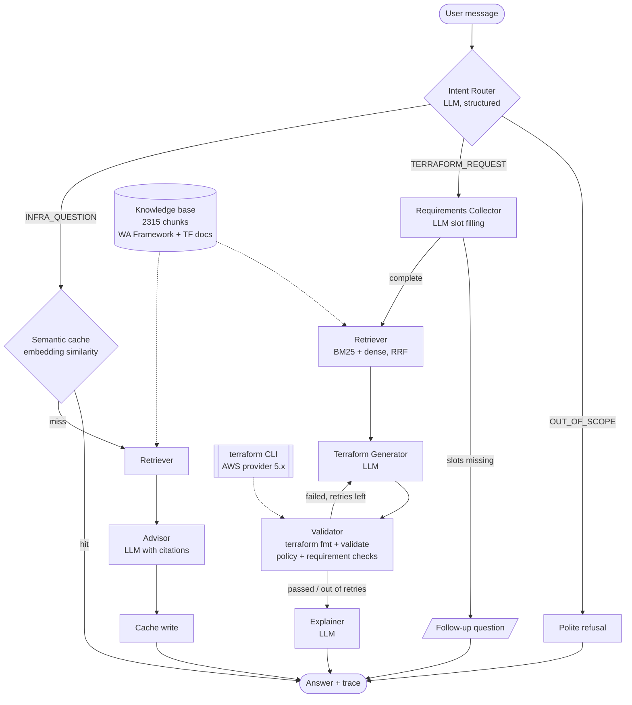

# multi-agent-iac-assistant (InfraPilot)

InfraPilot turns a plain-English description of a small AWS system into a Terraform configuration that
actually passes `terraform validate`, plus a short explanation of the design. If the description is missing
something important (availability, network access, database, budget...), it asks follow-up questions first.
It can also answer general AWS / DevOps questions with citations to the AWS Well-Architected Framework and
the Terraform AWS provider docs.

This is an upgrade of my earlier project [multi-agent-triage](https://github.com/Stalex575/multi-agent-triage)
(LangGraph router + two specialist agents + LLM QA retry loop + Pinecone semantic cache). What changed and why
is described in [Section 4](#4-what-was-reused-from-the-old-project-and-what-changed).

- Detailed evaluation numbers: [`docs/eval_report.md`](docs/eval_report.md)
- CRISP-DM log (how the project moved through the phases): [`docs/crisp_dm_log.md`](docs/crisp_dm_log.md)
- Coding agent setup: [`CLAUDE.md`](CLAUDE.md), [`.claude/skills/`](.claude/skills)

---

## 1. Task and scope

**User:** a developer who has to put a small service on AWS and does not want to write Terraform from scratch.

**Input:** chat messages, e.g. *"I need to host a Django web shop with Postgres, it must survive an AZ outage,
about 200 req/s, budget $400/month"*.

**Output:** a Terraform config (one file), the validator result, and an explanation that maps every requirement
to the resources that implement it, with a rough cost estimate.

Business rules kept in scope:

| Rule | How it is implemented |
|---|---|
| Collect requirements before generating anything | 6 required slots: workload, traffic, network access, availability, database, monthly budget. Optional: compute type, object storage, region, storage size. |
| Do not pester the user forever | At most 3 rounds of follow-up questions. After that, missing slots are filled with defaults and clearly listed as **assumptions** in the answer. |
| User can change their mind | The latest statement wins (e.g. "actually use MySQL"). Requirements are kept per conversation, so "make the DB multi-AZ" regenerates the config. |
| Config must be valid | `terraform fmt` + `terraform validate` against the real AWS provider (v5). On failure the errors go back to the generator, max 2 fix rounds. |
| Config must be safe by default | Policy rules from Well-Architected: encrypted and private databases, backups on, S3 public access blocked, no SSH/RDP/DB ports open to 0.0.0.0/0, encrypted EC2 disks. |
| Config must match what the user asked for | Requirement checks: multi-AZ really means multi-AZ subnets and `multi_az = true` on RDS, private means internal load balancers, the right DB engine, etc. |
| Only infra topics | Off-topic requests (recipes, homework, prompt injection) are refused politely. |
| Questions get grounded answers | Retrieval over AWS docs, inline citations `[n]`, repeated questions are served from a semantic cache. |

Out of scope: actually running `terraform apply`, multi-file modules, other clouds, exact cost calculation.

---

## 2. Architecture



Every arrow is a LangGraph edge. State is kept per conversation thread (LangGraph `MemorySaver`), so the
collector remembers what was said in earlier turns.

### Components

| # | Component | Purpose | Input | Output | Model / tool call |
|---|---|---|---|---|---|
| 1 | Intent Router | Decide which path handles the message | user message + last turns | `TERRAFORM_REQUEST` / `INFRA_QUESTION` / `OUT_OF_SCOPE` + reason | `gemini-3.1-flash-lite`, structured output. Skipped while the collector waits for answers. |
| 2 | Requirements Collector | Fill the requirement slots, ask for missing ones | current slots + conversation | updated slots, follow-up question or "complete" + list of assumed slots | `gemini-3.1-flash-lite`, structured output (`CollectorResult`). Missing slots and defaults are computed in code, not by the LLM. |
| 3 | Retriever | Give the generator real argument names and best practices | requirements turned into 4-6 queries (or the user question) | top chunks with source URLs | BM25 over 2315 chunks (local) + Gemini embeddings over 263 documents (cosine), fused with Reciprocal Rank Fusion |
| 4 | Terraform Generator | Write the config | requirements, assumptions, retrieved docs, validator errors on retries | HCL + design notes | `gemini-3.5-flash-lite`, structured output (`TerraformDraft`) |
| 5 | Validator | Check validity, safety, and that requirements are met | HCL + requirements | report: syntax, validate errors, policy findings, requirement checks, pass/fail | **No LLM.** `terraform fmt`, `terraform validate -json`, HCL parsing with `python-hcl2` |
| 6 | Explainer | Explain the design to the user | requirements, config, validator report | markdown explanation + cost estimate | `gemini-3.5-flash-lite` |
| 7 | Semantic Cache | Skip the LLM for repeated questions | question | cached answer if cosine >= threshold | Gemini embeddings |
| 8 | Advisor | Answer infra questions with citations | question + retrieved chunks | answer with `[n]` citations + source list | `gemini-3.5-flash-lite` |

### One input, end to end

Message: *"I need to host a Django web shop with PostgreSQL. It must survive an AZ outage, ~200 req/s, public
website, $400/month."*

1. **Router** sees a build request and returns `TERRAFORM_REQUEST`.
2. **Collector** extracts `workload=Django web shop, traffic=200 req/s, availability=multi_az, database=postgres,
   network_access=public_frontend_private_backend, monthly_budget_usd=400`. Nothing required is missing, so no
   follow-up. Region was not given, so `eu-central-1` is added and listed as an assumption.
3. **Retriever** builds queries like *"aws_db_instance postgres multi_az storage_encrypted ..."*,
   *"aws_launch_template aws_autoscaling_group aws_lb_target_group ..."* and *"deploy the workload to multiple
   Availability Zones"*, and returns chunks from `aws_db_instance`, `aws_autoscaling_group`, `REL10-BP01`, etc.
4. **Generator** writes VPC + subnets in 2 AZs + ALB + autoscaling group + RDS Postgres.
5. **Validator** runs `terraform validate`. Say the model used an argument that does not exist in provider v5:
   the error (`Unsupported argument ... line 42`) goes back to the generator together with the previous draft.
   Second draft passes validate, policy rules and the requirement checks (`multi_az.subnets`, `multi_az.database`,
   `database=postgres`, `network=public_frontend_private_backend`).
6. **Explainer** writes the architecture summary, which resource covers which requirement, the validator result
   and a cost range. The UI shows the answer and, on the right, the path through the graph, the timing of each
   node, the collected slots, retrieved docs and the full validator report.

---

## 3. Data

| Data | Source | Size | Used for |
|---|---|---|---|
| AWS Well-Architected Framework best practices (Reliability, Security, Cost, Performance) | docs.aws.amazon.com, downloaded by `scripts/fetch_docs.py` | 210 pages | best-practice context, advisor answers |
| Terraform AWS provider resource docs | `hashicorp/terraform-provider-aws` on GitHub | 53 resources | exact argument names and examples for the generator |
| Knowledge base after cleaning and chunking | `scripts/build_index.py` | 2315 chunks (1168 TF, 1147 WA), 263 document vectors | retrieval |
| Evaluation sets | written by hand, see below | 60 + 14 + 56 + 30 + 12 + 21 items | evaluation |

I looked for an existing dataset of "requirements -> Terraform" pairs with labels and did not find one that fits
small AWS services, so the evaluation sets in `data/eval/` are synthetic but written and checked by hand:

- `router.jsonl` - 60 messages (24 build requests, 22 infra questions, 14 off-topic incl. a prompt injection).
- `collector.jsonl` - 14 scripted conversations (1 to 3 user turns) with gold slot values, including a user who
  changes the database mid-conversation and one who starts with "I want to deploy something".
- `retrieval.jsonl` - 56 queries with relevant documents: 26 Terraform-syntax queries, 18 best-practice queries,
  12 paraphrased queries that do not use AWS vocabulary.
- `cache_pairs.jsonl` - 15 paraphrase pairs and 15 "near miss" pairs (same service, different question).
- `generation.jsonl` - 12 complete requirement sets covering EC2, ECS Fargate, Lambda, static site, private tools.
- validator cases - 21 configs built by breaking known-good configs on purpose (in `evals/eval_validator.py`).

---

## 4. What was reused from the old project and what changed

| Old (multi-agent-triage) | New | Why |
|---|---|---|
| Router: DB_INFRA vs CLOUD_DEVOPS | Router: build / question / off-topic | The new task needs to separate "build me something" from "explain something", and refuse off-topic input. |
| Single-shot query | Multi-turn requirements collector | The assignment brief needs requirements collected before generation. |
| 2 specialist agents writing free text | Terraform generator with structured output | Output has to be a config, not advice. |
| LLM "QA lead" deciding if the answer is good | Deterministic validator (terraform CLI + rules) | An LLM grading its own Terraform is unreliable. `terraform validate` gives a hard yes/no and exact errors to fix. |
| QA retry loop | Kept, now driven by validator errors | Same idea, much more useful feedback. |
| Pinecone (cache + 2 namespaces, 6 hand-written docs) | Local hybrid index over 2315 real doc chunks + local semantic cache | One API key instead of two, reproducible evals, BM25 helps with exact resource names. Dense vectors are per document (263) because the free embedding quota is 1000 texts/day. |
| No evaluation | 8 evals, one per component | Requirement of the assignment. |
| FastAPI endpoint | Gradio chat UI with a trace panel, CLI | Easier to demo and to see what each node did. |

---

## 5. Setup and run

Requirements: Python 3.11+, [uv](https://docs.astral.sh/uv/) (or pip), Terraform >= 1.5 on PATH, a Google AI
Studio API key.

```bash
uv venv --python 3.12 .venv && source .venv/bin/activate
uv pip install -r requirements.txt -e .
cp .env.example .env            # then put your GOOGLE_API_KEY into .env

# one-time: provider for offline `terraform validate`
terraform -chdir=terraform_sandbox init

# knowledge base (chunks are already in the repo; this downloads raw docs again and embeds them)
python scripts/fetch_docs.py    # optional, only if you want to rebuild from scratch
python scripts/build_index.py   # embeds 263 documents with Gemini (~5 min, paced for the free tier), resumable

python -m infra_assistant.ui    # web UI on http://127.0.0.1:7860
python -m infra_assistant.cli   # or a terminal chat
pytest -q                       # offline tests, no key needed
```

Optional LangSmith tracing: set `LANGSMITH_TRACING=true`, `LANGSMITH_API_KEY` and `LANGSMITH_PROJECT` in `.env`.
No code changes are needed, LangGraph sends every node and LLM call (prompt, output, tokens, latency) to
LangSmith. Evals were traced into a separate project (`LANGSMITH_PROJECT=iac-evals python -m evals.run_all`)
so the demo project only has demo conversations.

### Evaluation

```bash
python -m evals.run_all --offline           # validator + BM25 retrieval, no key needed
python -m evals.run_all --ablation          # everything, plus generation without RAG
python -m evals.make_report                 # writes docs/eval_report.md
```

Every eval writes one JSON line per item to `evals/results/` and skips items that are already there, so a run
that died because of the network can just be started again.

---

## 6. Evaluation

Each component has its own metric, chosen so that a bad component would actually get a low score.

| Component | Metric(s) | Why this metric |
|---|---|---|
| Intent Router | accuracy, macro-F1, confusion matrix, compared with a keyword baseline | 3-class classification; macro-F1 so the small OUT_OF_SCOPE class counts; the baseline shows whether the LLM is worth it |
| Requirements Collector | slot accuracy (strict and lenient), missing-slot detection P/R/F1 on turn 1, hallucinated slots, fully correct conversations, follow-ups per conversation | the two failure modes are inventing values and asking for things the user already said |
| Retriever | Hit@1, Hit@5, Recall@5, MRR, nDCG@5 for BM25, dense and hybrid | standard ranking metrics; comparing three modes shows why hybrid was chosen |
| Semantic Cache | precision / recall / F1 and false-hit rate over a threshold sweep | a false hit returns the answer to a different question, so false-hit rate matters more than recall |
| Generator + Validator loop | validate pass@1 vs pass@final, policy-clean rate, requirement coverage, attempts, latency; ablation without RAG | shows how good the first draft is, how much the fix loop adds and how much retrieval adds |
| Validator | decision accuracy, fail-detection P/R/F1, stage accuracy on 21 labelled configs | the validator is the "judge" of the generator, so it has to be checked itself |
| Explainer | LLM judge (faithfulness, coverage, clarity 1-5) + count of `aws_*` resources mentioned but not in the config | prose has no exact answer; the deterministic hallucination check backs up the judge |
| Advisor | LLM judge + share of answers with citations + invalid citation rate | the answer must be grounded in the retrieved docs |

### Results

All numbers below come from `evals/results/*.jsonl` (full tables in [`docs/eval_report.md`](docs/eval_report.md)).
Models: router/collector `gemini-3.1-flash-lite`, generator/explainer/advisor `gemini-3.5-flash-lite`,
judges `gemini-3.6-flash` (explainer) and `gemini-4-hydrogen` (advisor + explainer cross-check), embeddings `gemini-embedding-2`.
The eval sets are small, so treat differences of a few percent as noise.

**Summary**

| Component | Main metric | Result | Verdict |
|---|---|---|---|
| Intent Router | accuracy (easy / hard set) | 1.00 / 0.73 (keyword baseline 0.88 / 0.40) | good; scope edge cases are the weak spot |
| Requirements Collector | slot accuracy strict / lenient | 0.945 / 1.00 | good; one ambiguous enum |
| Retriever (hybrid) | Hit@5 / MRR | 0.982 / 0.877 (BM25 0.875 / 0.756) | good after the fusion fix |
| Semantic Cache | false-hit rate at chosen threshold 0.94 | 0.00 (0.133 at the old 0.92) | fixed by the eval |
| Generator + fix loop | all checks passed, first draft / final | 0.25 / 0.83 (no RAG: 0.00 / 0.58) | the weakest part, but the loop works |
| Validator | decision accuracy on labelled configs | 1.00 (21/21) | deterministic, as expected |
| Explainer | LLM-judge faithfulness (1-5) | 5.0 (lenient judge) / 4.0 (strict judge, 4 cases) | good, but the judges disagree |
| Advisor | LLM-judge faithfulness (1-5) / answers with citations | 2.5 / 0.92 | weakest part: answers go beyond the indexed docs |

#### 1. Intent Router (75 messages)

| | Accuracy | Macro-F1 | Easy set (60) | Hard set (15) |
|---|---|---|---|---|
| LLM router | 0.947 | 0.941 | 1.000 | 0.733 |
| Keyword baseline | 0.787 | - | 0.883 | 0.400 |

The first 60 messages were too easy: the router got all of them right, so I added 15 ambiguous ones. All 4 errors
are on the scope boundary: a boto3 script and a Dockerfile were treated as infra work (gold: out of scope),
"review this Terraform" was sent to the build path instead of being answered, and "Kubernetes on a Raspberry Pi"
was refused as "not AWS" although it is a DevOps question. Some of these labels are debatable, which is the point
of the hard set. Improvement: describe the scope boundary in the router prompt with 2-3 examples of each edge case
(application code vs infrastructure code, review vs build).

#### 2. Requirements Collector (14 conversations, 1-3 user turns)

| Metric | Value |
|---|---|
| Slot accuracy (strict / lenient) | 0.945 / 1.000 |
| Missing-slot detection after turn 1 (P / R / F1) | 1.000 / 0.955 / 0.977 |
| Slots filled that the user had not given yet | 2 |
| Conversations fully correct | 14 / 14 |
| Follow-up questions per conversation | 1.07 |

All strict errors are the same thing: for a public site with a database the model says `public` where my gold
label says `public_frontend_private_backend` (5 of 14). The two values overlap; merging them would remove the error
and lose nothing, because the policy rules already force the database to be private. The 2 "unasked" slots are
reasonable guesses ("internal HR tool" -> private network, static site -> single AZ), not invented facts.

#### 3. Retriever (56 queries, relevance at document level)

| Metric | BM25 | Dense | Hybrid v1 (chunk RRF) | Hybrid (doc RRF, final) |
|---|---|---|---|---|
| Hit@1 | 0.661 | 0.893 | 0.571 | 0.786 |
| Hit@5 | 0.875 | 1.000 | 0.857 | 0.982 |
| Recall@5 | 0.807 | 0.941 | 0.798 | 0.879 |
| MRR | 0.756 | 0.942 | 0.703 | 0.877 |
| nDCG@5 | 0.737 | 0.914 | 0.700 | 0.828 |
| Hit@5 Terraform-syntax queries (26) | 1.000 | 1.000 | 0.962 | 1.000 |
| Hit@5 best-practice queries (18) | 1.000 | 1.000 | 1.000 | 1.000 |
| Hit@5 paraphrased queries (12) | 0.417 | 1.000 | 0.417 | 0.917 |

- BM25 is perfect when the query contains AWS words and falls apart on plain-language queries ("get an email when
  CPU is too high"). Dense handles both.
- The first hybrid version was worse than dense alone. Reason: fusion was done per chunk, BM25 votes once for every
  chunk, dense once per document, so BM25 noise outvoted good dense results. Fixing it to fuse per document gave
  Hit@5 0.857 -> 0.982.
- On this set dense alone still has the best MRR. Hybrid is kept because dense only has one vector per document
  (free-tier embedding quota), and BM25 is what picks the right paragraph inside the document, which matters for the
  generator (it needs the exact "Argument Reference" part). Weighting dense x2 in the fusion reaches Hit@5 1.0 in a
  simulation, but that would be tuned on the test set, so it is listed as a next step instead.

#### 4. Semantic Cache (15 paraphrase pairs, 15 near-miss pairs)

| Threshold | Precision | Recall | F1 | False-hit rate |
|---|---|---|---|---|
| 0.88 | 0.682 | 1.000 | 0.811 | 0.467 |
| 0.90 | 0.833 | 1.000 | 0.909 | 0.200 |
| 0.92 (old setting) | 0.882 | 1.000 | 0.938 | 0.133 |
| 0.94 (new setting) | 1.000 | 0.867 | 0.929 | 0.000 |
| 0.96 | 1.000 | 0.533 | 0.696 | 0.000 |

Paraphrases have cosine 0.961 on average, near misses 0.874, but the hardest near misses are very close:
"enable PITR for DynamoDB" vs "for RDS" = 0.923, "Fargate vs EC2 cost" vs "Lambda vs EC2 cost" = 0.922. With the old
threshold of 0.92 these get the wrong cached answer. A false hit is much worse than a miss (a miss only costs one
extra LLM call), so the threshold was raised to 0.94.

#### 5. Validator (21 labelled configs, offline)

Decision accuracy 1.000, fail-detection P/R/F1 1.000, the right stage (syntax / validate / policy / requirement)
in 21/21 cases. The first run "failed" 2 cases that turned out to be my labelling mistakes (an S3 bucket with public
access blocked was labelled as satisfying "public access"). This component is plain code, so a perfect score is
expected; the eval exists because the validator is the judge of the generator and has to be trusted.

#### 6. Terraform Generator + Validator loop (12 requirement sets, max 2 fix rounds)

| Metric | With retrieval | Without retrieval (ablation) |
|---|---|---|
| `terraform validate` pass, first draft | 0.333 | 0.083 |
| `terraform validate` pass, after fix loop | 0.833 | 0.583 |
| No HIGH policy findings (first / final) | 1.000 / 1.000 | 1.000 / 1.000 |
| Requirement coverage (final) | 1.000 | 1.000 |
| All checks passed (first / final) | 0.250 / **0.833** | 0.000 / 0.583 |
| Attempts per case | 2.17 | 2.58 |
| Latency per case | 20.2 s | 14.6 s |

- **The fix loop is the biggest win:** only 3 of 12 first drafts pass everything, 10 of 12 do after feeding the
  `terraform validate` errors back. Typical first-draft errors: a required argument missing (`subnet_ids`), the
  same attribute written twice, a typo in an argument name (`ignore_public_ccls`), a reference to a resource that was
  never declared, and twice "network=private" requirement failures (internet-facing load balancer for an internal tool).
- **Retrieval helps** (0.583 -> 0.833 final). Part of the gap is formatting: without doc examples in the prompt the
  model often packed the whole config into one line, which Terraform rejects, and the fix loop did not get it out of
  that habit. So retrieval helps both with argument names and by showing what normal HCL looks like.
- **Security rules were never violated** in any final config, even without retrieval: the rules are in the
  generator prompt and the validator would catch them anyway.
- **The 2 remaining failures:** a Lambda case that kept using an `inline_code` block that does not exist (and tried
  the `archive` provider, which the offline sandbox does not have - an environment limitation, fixable by
  pre-installing `hashicorp/archive`), and an ECS case that kept putting `subnet_ids` in the wrong block.
  Improvement: when the same error repeats, retrieve the docs for the resource named in the error message before
  the next fix attempt (right now retrieval happens only once, before the first draft).

#### 7. Explainer (12 explanations from the generation run)

| Metric | Judge `gemini-3.6-flash` (all 12) | Judge `gemini-4-hydrogen` (4 re-judged) |
|---|---|---|
| Faithfulness (1-5) | 5.00 | 4.00 |
| Coverage (1-5) | 5.00 | 3.50 |
| Clarity (1-5) | 5.00 | 4.00 |
| `aws_*` resources mentioned but not in the config | 0 / 12 | - |

A perfect 5.0 on everything looked more like a lenient judge than perfect explanations, so I re-judged 4 of them
(2 that passed validation, 2 that failed) with `gemini-4-hydrogen`, the strict judge that also graded the advisor.
It gave 4/4/4/4 and found one real issue (an explanation implies private instances can reach the internet although
there is no NAT gateway) and one false alarm (it says the region is "not in the config", but the region is injected by
our sandbox, so the judge simply did not see it). Both judges agree that the explanations report the validator result
honestly, including the two failed cases. The deterministic check backs this up: no explanation names a resource type
that is not in the config.
Takeaways: (1) LLM-judge scores depend a lot on which model judges, so absolute numbers should not be compared
across components judged by different models; (2) give the judge the same context the explainer had (the injected
`versions.tf` and region). The original plan was `gemini-3.8-flash` as the explainer judge, but it returned 503 "high
demand" errors during the run, so I switched to 3.6-flash.

#### 8. Advisor, question path (12 questions, judge `gemini-4-hydrogen`)

| Metric | Value |
|---|---|
| Faithfulness to retrieved docs (1-5) | 2.50 |
| Coverage / clarity (1-5) | 4.00 / 4.25 |
| Answers with at least one citation | 0.917 |
| Citations pointing to a non-existent source | 0.000 |

This is the weakest component and the judge's reasons show why. 9 of 12 answers got faithfulness 2 because of the
rule "any claim not supported by the excerpts caps the score at 2". In 7 of those 9 the extra claims are actually
correct (NAT gateway pricing, how Terraform state locking works, synchronous replication in Multi-AZ RDS), they just
are not in the knowledge base: we indexed the Terraform reference and the Well-Architected Framework, not the
service user guides that explain behaviour. The advisor prompt also allows "general best practice without a
citation", so the two prompts disagree on purpose. Two answers have real problems: one attributes a claim to a
source that does not say it, one misreads a reference (Aurora "needs exactly 3 AZs").
So the score says "not grounded in our docs", not "wrong". Improvements: add the RDS / VPC / S3 user guides to the
corpus, and make the advisor mark general-knowledge sentences explicitly (or refuse to go beyond the excerpts).

---

## 7. How the coding agent was set up

The code was written together with an AI coding agent (Claude Code). I steered it with files, not only with
chat prompts:

- **[`CLAUDE.md`](CLAUDE.md)** (and `AGENTS.md` pointing to it for other tools) is loaded on every session. It
  contains the project summary, the mandatory CRISP-DM order of work, hard rules (never read `.env`, one LLM
  provider, structured outputs for anything that drives control flow, deterministic checks instead of LLM checks
  where possible, no provider blocks in generated Terraform, tests must run offline, evals must be resumable),
  code conventions (where prompts, nodes and wiring live) and a definition of done.
- **Skills** in `.claude/skills/`, small playbooks the agent loads when a task matches:
  - `add-graph-node` - the 6 steps for a new pipeline component (contract, schema, prompt, node, wiring, test + eval);
  - `run-evals` - how to run, read and interpret the evals, including a metric cheat sheet;
  - `crisp-dm-log` - the template for entries in `docs/crisp_dm_log.md`.
- **Context control:** the agent got the assignment PDF and the old repo as context; the old repo was copied to
  a git-ignored `legacy/` folder to be used as reference only. Personal rules were stored separately (no AI
  co-author lines in commits, nothing is pushed without my permission, never look into API keys).
- **What worked / what did not:** the rule "deterministic check first" led to the validator replacing the LLM QA
  node, which was the biggest quality gain. Writing the eval sets first caught a mistake early: the first retrieval
  set was too easy (queries contained resource names), so a paraphrased group was added. The agent sometimes
  over-engineered things, so I asked for simpler code and kept the review on my side.

---

## 8. Limitations and next steps

- Eval sets are small (written by hand); numbers have wide error bars.
- Requirement checks cover the main slots, not everything (e.g. budget is only used in the prompt, there is no
  real cost check; Infracost would be the next step).
- The validator only checks what `terraform validate` can check without AWS credentials (no `plan`), and the
  offline sandbox only has the `hashicorp/aws` provider, so configs that use e.g. `archive` or `random` fail.
- The advisor answers beyond the indexed documents (see eval 8); the corpus needs the AWS service user guides.
- Judge scores depend on the judge model; two judges disagreed by ~1 point on the explainer.
- One Terraform file per answer; no modules or remote state.
- Gemini free tier rate limits make the full eval run slow (~15 requests/minute).
